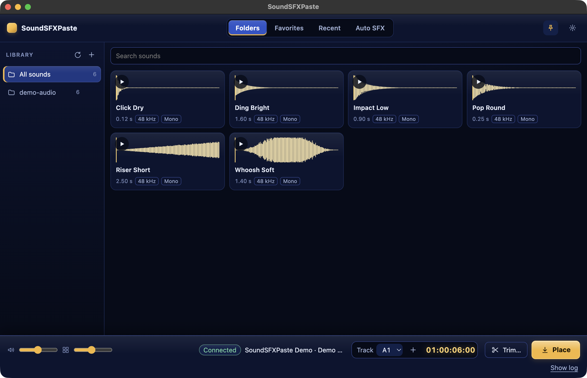

# SoundSFXPaste

[English](README.md) · [Română](README.ro.md) · [Español](README.es.md)

Panel de biblioteca de efectos de sonido para DaVinci Resolve: explora con formas de onda reales, escucha y coloca en la línea de tiempo con seguridad.

## Funciones

- Cuadrícula de carpetas con formas de onda reales, escucha, Favoritos y Recientes.
- Colocación en el cursor sobre la pista elegida; pista y posición visibles junto al botón Colocar.
- Colocación segura: cada escritura se planifica, se verifica y se revierte si difiere.
- Auto SFX: Relleno aleatorio en marcadores, Reemplazo, gestión de marcadores, Rapid Mapping.
- Panel «Verificación y dependencias» en lenguaje sencillo (Python, scripting de Resolve, proyecto, timeline, frame rate).
- Inglés, rumano, español. Gratis y de código abierto (MIT); sin activación.

## Requisitos

- macOS con DaVinci Resolve Studio 21 (Workflow Integrations).
- Python 3.8 o superior en el sistema (el panel indica qué hacer si falta).
- Resolve > Preferences > General > External scripting using: Local.

## Instalación

Descarga el instalador firmado y notarizado desde Releases, ejecútalo y abre Workspace > Workflow Integrations > SoundSFXPaste.

## Límites conocidos

- Las líneas de tiempo drop-frame se rechazan (se indica en el panel de dependencias).
- Resolve no tiene API para fijar la selección ni renombrar marcadores; Reemplazar usa la selección actual o el clip bajo el cursor.
- Solo macOS por ahora.
- Arrastrar un sonido directo a la línea de tiempo no está disponible; se coloca con el botón Colocar.

## Contribuir

Se aceptan incidencias y pull requests; consulta [CONTRIBUTING.md](CONTRIBUTING.md). Documentación: [gordas.dev/soundsfxpaste](https://gordas.dev/soundsfxpaste/es/).

## Documentación

Manuales ilustrados paso a paso (PDF, 20 páginas cada uno), regenerados con `python3 scripts/build_manual.py`:

- [Manual PDF — Română](https://gordas.dev/soundsfxpaste/manual/SoundSFXPaste-Manual-RO-0.2.0.pdf)
- [PDF manual — English](https://gordas.dev/soundsfxpaste/manual/SoundSFXPaste-Manual-EN-0.2.0.pdf)
- [Manual PDF — Español](https://gordas.dev/soundsfxpaste/manual/SoundSFXPaste-Manual-ES-0.2.0.pdf)
- Tutoriales en vídeo (sin voz, interfaz en rumano): https://gordas.dev/soundsfxpaste/es/#clip-1

<!-- tutorials:start -->
## Tutoriales

Un tutorial escrito por cada clip (los clips están grabados con la interfaz en rumano, sin voz). Las explicaciones completas están en el manual PDF; el mismo texto está en la página del producto.

### 1. Deschide panoul și adaugă un folder de sunete

Ver el clip: [https://gordas.dev/soundsfxpaste/es/#clip-1](https://gordas.dev/soundsfxpaste/es/#clip-1) · [MP4](https://gordas.dev/soundsfxpaste/video/01-deschide-panoul-si-adauga-un-folder-de-sunete.mp4)

El panel SoundSFXPaste abierto en Resolve con una biblioteca de sonidos cargada.

1. En Resolve elige Workspace › Workflow Integrations › SoundSFXPaste.
2. Espera a la ventana del panel; la barra inferior debe decir «Conectado».
3. En la columna **Biblioteca** pulsa + (**Añadir carpeta**).
4. En la ventana de Finder elige la carpeta demo-audio y confirma.
5. Abre **Todos los sonidos** y mira las tarjetas.

**Resultado:** La carpeta aparece en **Biblioteca** con el número 6 y **Todos los sonidos** muestra seis tarjetas con formas de onda.

**Si difiere:** El panel no aparece: comprueba que usas Resolve Studio (la versión gratuita no ejecuta paneles) y repite el menú. El indicador dice «Sin conexión»: abre un proyecto y un timeline en Resolve. Falta la carpeta: pulsa **Actualizar** o añádela de nuevo; los archivos del disco nunca se borran al quitar una carpeta.

### 2. Caută, ascultă și plasează un sunet la cursor

Ver el clip: [https://gordas.dev/soundsfxpaste/es/#clip-2](https://gordas.dev/soundsfxpaste/es/#clip-2) · [MP4](https://gordas.dev/soundsfxpaste/video/02-cauta-asculta-si-plaseaza-un-sunet-la-cursor.mp4)

Un sonido encontrado por búsqueda, escuchado y colocado en el timeline justo en el cursor.

1. En Resolve coloca el cursor en 01:00:05:00.
2. En el panel, en **Buscar sonidos**, escribe «whoosh»; queda una sola tarjeta.
3. Pulsa ► en la tarjeta (**Escuchar**); el botón pasa a **Parar** mientras suena. No cambia nada en el timeline.
4. Pulsa la tarjeta para elegirla (contorno dorado).
5. En la barra inferior comprueba **Pista** = A1 y el timecode amarillo 01:00:05:00.
6. Pulsa **Colocar**.

**Resultado:** Mensaje verde: «Whoosh Soft» colocado en A1 en 01:00:05:00 (1,4 s); un clip nuevo en A1; el cursor salta a 01:00:06:09, el final del clip.

**Si difiere:** Cmd+Z en Resolve o borra el clip. Colocación rechazada (la pista ya tiene un clip ahí): elige otra pista o pulsa **Añadir pista** y repite. El sonido es demasiado largo: el panel pide una segunda pulsación en **Colocar** para confirmar.

### 3. Scurtează un sunet

Ver el clip: [https://gordas.dev/soundsfxpaste/es/#clip-3](https://gordas.dev/soundsfxpaste/es/#clip-3) · [MP4](https://gordas.dev/soundsfxpaste/video/03-scurteaza-un-sunet.mp4)

De Riser Short (2,5 s) colocas solo el segundo entre 0,80 s y 1,80 s.

1. Elige la tarjeta Riser Short.
2. Pulsa **Recortar…**; se abre «Recortar antes de colocar» con la onda del sonido.
3. Primer clic: en la onda, a 0,80 s (aproximadamente un tercio del ancho). Mueve el inicio del rango.
4. Segundo clic: en la onda, a 1,80 s (aproximadamente tres cuartos). Mueve el final.
5. Lee bajo la onda «0.80 s → 1.80 s»; la parte elegida aparece iluminada.
6. Pulsa **Colocar recorte**.

**Resultado:** Un clip de 1 s (24 fotogramas a 24 fps) en A1 en 01:00:03:00; mensaje verde «Riser Short» colocado en A1 en 01:00:03:00 (1,0 s); el cursor salta al final del clip.

**Si difiere:** Un clic mueve el extremo más cercano; no crea un rango nuevo. Números distintos: pulsa **Borrar selección** y repite los dos clics. **Cancelar** (o Esc) cierra sin colocar. Tras colocar, Cmd+Z en Resolve.

### 4. Înlocuiește un sunet în timeline

Ver el clip: [https://gordas.dev/soundsfxpaste/es/#clip-4](https://gordas.dev/soundsfxpaste/es/#clip-4) · [MP4](https://gordas.dev/soundsfxpaste/video/04-inlocuieste-un-sunet-in-timeline.mp4)

Un clip del timeline cambiado por otro sonido, en la misma pista y en el mismo timecode.

1. En **Carpetas** elige la tarjeta Ding Bright (el sonido nuevo).
2. Abre **Auto SFX** › **Reemplazar**.
3. En **Objetivo** elige **Clip bajo el cabezal**.
4. Pulsa **Vista previa** y lee la tabla: qué clip se reemplaza y por cuál.
5. Si es el que quieres, pulsa **Reemplazar**.

**Resultado:** El mensaje «1 clip(s) reemplazados.»; en A1, en 01:00:05:00, el clip se llama ahora Ding Bright.

**Si difiere:** Cmd+Z en Resolve devuelve el clip antiguo. La tabla de vista previa no es la que quieres: no pulses **Reemplazar**; cambia **Objetivo** o mueve el cursor. Mensaje «No hay clip que reemplazar: selecciona clips en Resolve o sitúa el cabezal sobre uno.»: coloca el cursor sobre un clip o selecciona clips en Resolve.

### 5. Folosește markere și etichete

Ver el clip: [https://gordas.dev/soundsfxpaste/es/#clip-5](https://gordas.dev/soundsfxpaste/es/#clip-5) · [MP4](https://gordas.dev/soundsfxpaste/video/05-foloseste-markere-si-etichete.mp4)

Los marcadores del timeline reciben nombres claros y etiquetas, directamente desde el panel.

1. Abre **Auto SFX** › **Gestionar marcadores**.
2. En la primera fila, en **Nombre del marcador**, escribe «Door slam» y pulsa Tab.
3. En **Etiquetas** escribe «door» y pulsa Enter.
4. Mira la fila y el marcador del timeline.

**Resultado:** El mensaje «Marcadores actualizados.»; la fila muestra el nuevo nombre y la burbuja «door»; el marcador del timeline tiene el nombre nuevo.

**Si difiere:** Reescribe el nombre o pulsa × en la etiqueta. Borrar un marcador no se deshace desde el panel: usa Cmd+Z en Resolve justo después. «No hay marcadores en esta línea de tiempo.»: añade marcadores al timeline.

### 6. Completează markerele cu sunete aleatorii

Ver el clip: [https://gordas.dev/soundsfxpaste/es/#clip-6](https://gordas.dev/soundsfxpaste/es/#clip-6) · [MP4](https://gordas.dev/soundsfxpaste/video/06-completeaza-markerele-cu-sunete-aleatorii.mp4)

Un sonido corto, elegido al azar, en cada marcador, en una sola aplicación.

1. En la barra inferior elige **Pista** = A1.
2. Abre **Auto SFX** › **Random Fill**.
3. Configura **Elegir de** = **Carpeta actual** y **Duración máxima (s)** = 5.
4. Pulsa **Planificar** y lee el plan (qué sonido va en qué marcador).
5. ¿No te gusta? Pulsa **Mezclar de nuevo** hasta que te convenza.
6. Pulsa **Aplicar 3 sonidos**.

**Resultado:** El mensaje «3 marcadores rellenados en A1.» y tres clips en A1, uno en cada marcador. El plan sigue visible.

**Si difiere:** Cmd+Z tres veces en Resolve (un paso por clip) o selecciona los tres clips y bórralos. Plan vacío: «No hay marcadores en esta línea de tiempo.» o «Ningún sonido de esta fuente es lo bastante corto (o su duración aún no se conoce).»; añade marcadores o sube **Duración máxima (s)** y pulsa **Planificar** de nuevo.

### 7. Asociază rapid sunete cu markerele

Ver el clip: [https://gordas.dev/soundsfxpaste/es/#clip-7](https://gordas.dev/soundsfxpaste/es/#clip-7) · [MP4](https://gordas.dev/soundsfxpaste/video/07-asociaza-rapid-sunete-cu-markerele.mp4)

Eliges tú el sonido para cada marcador, uno a uno, sin mover el cursor a mano.

1. Elige la pista A2 en la barra inferior (**Pista**).
2. Abre **Auto SFX** › **Rapid Mapping** y pulsa **Empezar mapeo**.
3. El cursor salta al primer marcador; el banner muestra el destino («Hit 1 (1/3)»).
4. En **Carpetas** pulsa la tarjeta Ding Bright (solo la elige) y luego pulsa **Colocar**.
5. El destino pasa a Hit 2: elige Impact Low y pulsa **Colocar**; en Hit 3: Whoosh Soft y **Colocar**.
6. Si un marcador no necesita sonido, pulsa **Saltar**.

**Resultado:** Tras cada **Colocar**, el mensaje «Ding Bright» colocado en A2 en 01:00:01:00 (el timecode del marcador) y el destino pasa al siguiente marcador; al final «Se recorrieron los 3 marcadores.».

**Si difiere:** **Anterior** vuelve al marcador anterior para colocar otra vez; **Salir** detiene el mapeo; un clip equivocado se deshace con Cmd+Z en Resolve. «El mapeo necesita al menos un marcador.»: añade marcadores. Si se rechaza una colocación, el destino se queda en el mismo marcador: cambia la pista o pulsa **Saltar**.

<!-- tutorials:end -->

## Licencia

MIT. Autor: Dumitru Cristinel Gordas (GDC). El apoyo es opcional y se hace como donación. Ver NOTICE.md y docs/PROVENANCE.md.
