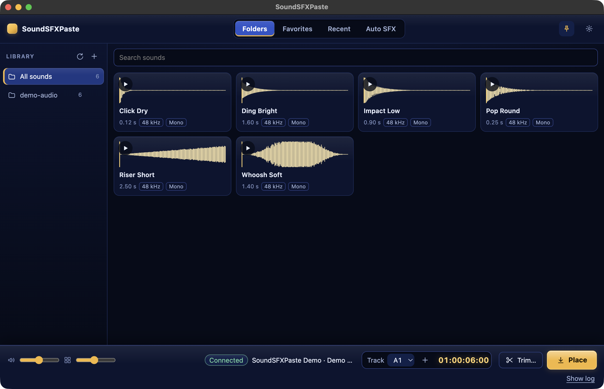

# SoundSFXPaste

[English](README.md) · [Română](README.ro.md) · [Español](README.es.md)

A sound-effects library panel for DaVinci Resolve: browse with real waveforms, audition, and place on the timeline safely.

## Features

- Folder grid with real waveforms, audition on hover or click, Favorites and Recents.
- Place at the playhead on a chosen track; track and position are shown next to the Place button.
- Safe placement: every write is planned first, verified afterwards and rolled back if it differs.
- Auto SFX: Random Fill on markers, Replace, marker management, Rapid Mapping.
- Plain-language "Verify & Dependencies" panel (Python, Resolve scripting, project, timeline, frame rate).
- English, Romanian, Spanish. Free and open source (MIT); no activation.

## Requirements

- macOS with DaVinci Resolve Studio 21 (Workflow Integrations).
- Python 3.8 or newer on the system (the panel tells you what to do if it is missing).
- Resolve > Preferences > General > External scripting using: Local.

## Install

Download the signed and notarized installer from the Releases page, run it, then open Workspace > Workflow Integrations > SoundSFXPaste.

## Known limits

- Drop-frame timelines are refused (reported in the dependencies panel).
- Resolve has no API to set a clip selection or rename markers; Replace works on the current selection or the clip under the playhead.
- macOS only for now.
- Dragging a sound straight onto the timeline is not available; placement uses the Place button.

## Contributing

Issues and pull requests are welcome; see [CONTRIBUTING.md](CONTRIBUTING.md). Documentation: [gordas.dev/soundsfxpaste](https://gordas.dev/soundsfxpaste/).

## Licence

MIT. Author: Dumitru Cristinel Gordas (GDC). Support is optional and takes the form of a donation. See NOTICE.md and docs/PROVENANCE.md.
