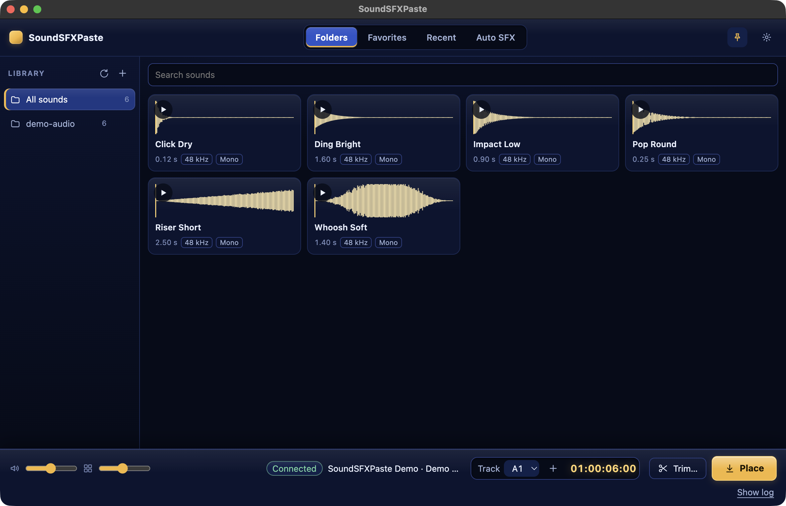

# SoundSFXPaste

[English](README.md) · [Română](README.ro.md) · [Español](README.es.md)

Panou cu bibliotecă de efecte sonore pentru DaVinci Resolve: răsfoiești cu forme de undă reale, asculți și plasezi sigur pe timeline.

## Funcționalități

- Grilă de foldere cu forme de undă reale, ascultare, Favorite și Recente.
- Plasare la cursor pe pista aleasă; pista și poziția se văd lângă butonul Plasează.
- Plasare sigură: fiecare scriere e planificată, verificată după și anulată dacă diferă.
- Auto SFX: Umplere aleatorie pe markere, Înlocuire, gestionare markere, Rapid Mapping.
- Panou „Verificare & Dependențe” în limbaj simplu (Python, scripting Resolve, proiect, timeline, frame rate).
- Engleză, română, spaniolă. Gratuit și open source (MIT); fără activare.

## Cerințe

- macOS cu DaVinci Resolve Studio 21 (Workflow Integrations).
- Python 3.8 sau mai nou în sistem (panoul spune ce ai de făcut dacă lipsește).
- Resolve > Preferences > General > External scripting using: Local.

## Instalare

Descarcă installerul semnat și notarizat din pagina Releases, rulează-l, apoi deschide Workspace > Workflow Integrations > SoundSFXPaste.

## Limite cunoscute

- Timeline-urile drop-frame sunt refuzate (apare în panoul de dependențe).
- Resolve nu are API pentru setarea selecției sau redenumirea markerelor; Înlocuirea lucrează pe selecția curentă sau pe clipul de sub cursor.
- Deocamdată doar macOS.
- Tragerea unui sunet direct pe timeline nu este disponibilă; plasarea se face cu butonul Plasează.

## Contribuții

Sesizările și pull request-urile sunt binevenite; vezi [CONTRIBUTING.md](CONTRIBUTING.md). Documentație: [gordas.dev/soundsfxpaste](https://gordas.dev/soundsfxpaste/).

## Documentație

Manuale ilustrate, pas cu pas (PDF, 20 pagini fiecare), regenerate cu `python3 scripts/build_manual.py`:

- [Manual PDF — Română](https://gordas.dev/soundsfxpaste/manual/SoundSFXPaste-Manual-RO-0.2.0.pdf)
- [PDF manual — English](https://gordas.dev/soundsfxpaste/manual/SoundSFXPaste-Manual-EN-0.2.0.pdf)
- [Manual PDF — Español](https://gordas.dev/soundsfxpaste/manual/SoundSFXPaste-Manual-ES-0.2.0.pdf)
- Tutoriale video (fără voce, interfață în română): https://gordas.dev/soundsfxpaste/#clip-1

<!-- tutorials:start -->
## Tutoriale

Câte un tutorial scris pentru fiecare clip (clipurile sunt filmate cu interfața în română, fără voce). Explicațiile complete sunt în manualul PDF; același text e pe pagina produsului.

### 1. Deschide panoul și adaugă un folder de sunete

Vezi clipul: [https://gordas.dev/soundsfxpaste/#clip-1](https://gordas.dev/soundsfxpaste/#clip-1) · [MP4](https://gordas.dev/soundsfxpaste/video/01-deschide-panoul-si-adauga-un-folder-de-sunete.mp4)

Panoul SoundSFXPaste deschis în Resolve și o bibliotecă de sunete încărcată în el.

1. În Resolve alege Workspace › Workflow Integrations › SoundSFXPaste.
2. Așteaptă fereastra panoului; în bara de jos trebuie să apară „Conectat”.
3. În coloana **Bibliotecă** apasă + (**Adaugă folder**).
4. În fereastra Finder alege folderul demo-audio și confirmă.
5. Deschide **Toate sunetele** și privește cardurile.

**Rezultat:** Folderul apare în **Bibliotecă** cu cifra 6, iar **Toate sunetele** arată șase carduri cu forme de undă.

**Dacă diferă:** Panoul nu apare: verifică Resolve Studio (versiunea gratuită nu rulează panouri) și repetă meniul. Indicatorul arată „Neconectat”: deschide un proiect și un timeline în Resolve. Folderul nu apare: apasă **Reîmprospătează** sau adaugă-l din nou; fișierele de pe disc nu se șterg niciodată când scoți un folder.

### 2. Caută, ascultă și plasează un sunet la cursor

Vezi clipul: [https://gordas.dev/soundsfxpaste/#clip-2](https://gordas.dev/soundsfxpaste/#clip-2) · [MP4](https://gordas.dev/soundsfxpaste/video/02-cauta-asculta-si-plaseaza-un-sunet-la-cursor.mp4)

Un sunet găsit prin căutare, ascultat și pus pe timeline exact unde e cursorul.

1. În Resolve pune cursorul pe 01:00:05:00.
2. În panou, în **Caută sunete**, scrie „whoosh”; rămâne un singur card.
3. Apasă ► pe card (**Ascultă**); butonul devine **Oprește** cât timp sună. Nu se schimbă nimic în timeline.
4. Apasă pe card ca să-l alegi (contur auriu).
5. În bara de jos verifică **Pistă** = A1 și timecode-ul galben 01:00:05:00.
6. Apasă **Plasează**.

**Rezultat:** Mesaj verde „Whoosh Soft” plasat pe A1 la 01:00:05:00 (1,4 s); un clip nou pe A1; cursorul sare la 01:00:06:09, la capătul clipului.

**Dacă diferă:** Cmd+Z în Resolve sau șterge clipul. Plasarea e refuzată (pista are deja un clip acolo): alege altă pistă sau apasă **Adaugă pistă** și repetă. Sunetul e prea lung: panoul cere o a doua apăsare pe **Plasează** ca să confirmi.

### 3. Scurtează un sunet

Vezi clipul: [https://gordas.dev/soundsfxpaste/#clip-3](https://gordas.dev/soundsfxpaste/#clip-3) · [MP4](https://gordas.dev/soundsfxpaste/video/03-scurteaza-un-sunet.mp4)

Din Riser Short (2,5 s) pui pe timeline doar secunda dintre 0,80 s și 1,80 s.

1. Alege cardul Riser Short.
2. Apasă **Taie…**; se deschide „Taie înainte de plasare” cu unda sunetului.
3. Primul click: pe undă, la 0,80 s (aproximativ o treime din lățime). Se mută începutul intervalului.
4. Al doilea click: pe undă, la 1,80 s (aproximativ trei sferturi). Se mută sfârșitul.
5. Citește sub undă „0.80 s → 1.80 s”; porțiunea aleasă e luminată.
6. Apasă **Plasează porțiunea**.

**Rezultat:** Un clip de 1 s (24 de cadre la 24 fps) pe A1, la 01:00:03:00; mesaj verde „Riser Short” plasat pe A1 la 01:00:03:00 (1,0 s); cursorul sare la capătul clipului.

**Dacă diferă:** Un click mută capătul cel mai apropiat, nu creează un interval nou. Numerele sunt altele: apasă **Șterge selecția** și repetă cele două clicuri. **Anulează** (sau Esc) închide fără să plaseze. După plasare, Cmd+Z în Resolve.

### 4. Înlocuiește un sunet în timeline

Vezi clipul: [https://gordas.dev/soundsfxpaste/#clip-4](https://gordas.dev/soundsfxpaste/#clip-4) · [MP4](https://gordas.dev/soundsfxpaste/video/04-inlocuieste-un-sunet-in-timeline.mp4)

Un clip din timeline înlocuit cu alt sunet, pe aceeași pistă și la același timecode.

1. În **Foldere** alege cardul Ding Bright (sunetul nou).
2. Deschide **Auto SFX** › **Înlocuire**.
3. La **Țintă** alege **Clipul de sub cursor**.
4. Apasă **Previzualizare** și citește tabelul: ce clip e înlocuit și cu ce.
5. Dacă e cel dorit, apasă **Înlocuiește**.

**Rezultat:** Mesajul „1 clip(uri) înlocuite.”; pe A1, la 01:00:05:00, clipul se numește acum Ding Bright.

**Dacă diferă:** Cmd+Z în Resolve readuce clipul vechi. Tabelul de previzualizare nu e cel dorit: nu apăsa **Înlocuiește**; schimbă **Țintă** sau mută cursorul. Mesaj „Niciun clip de înlocuit: selectează clipuri în Resolve sau pune cursorul peste unul.”: pune cursorul peste un clip sau selectează clipuri în Resolve.

### 5. Folosește markere și etichete

Vezi clipul: [https://gordas.dev/soundsfxpaste/#clip-5](https://gordas.dev/soundsfxpaste/#clip-5) · [MP4](https://gordas.dev/soundsfxpaste/video/05-foloseste-markere-si-etichete.mp4)

Markerele timeline-ului primesc nume clare și etichete, direct din panou.

1. Deschide **Auto SFX** › **Gestionare markere**.
2. La primul rând, în **Numele markerului**, scrie „Door slam” și apasă Tab.
3. În **Etichete** scrie „door” și apasă Enter.
4. Privește rândul și markerul din timeline.

**Rezultat:** Mesajul „Markere actualizate.”; rândul arată noul nume și bula „door”; markerul din timeline are numele nou.

**Dacă diferă:** Rescrie numele sau apasă × pe etichetă. Ștergerea unui marker nu se anulează din panou: folosește Cmd+Z în Resolve imediat după. „Nu există markere pe acest timeline.”: adaugă markere în timeline.

### 6. Completează markerele cu sunete aleatorii

Vezi clipul: [https://gordas.dev/soundsfxpaste/#clip-6](https://gordas.dev/soundsfxpaste/#clip-6) · [MP4](https://gordas.dev/soundsfxpaste/video/06-completeaza-markerele-cu-sunete-aleatorii.mp4)

Un sunet scurt, ales la întâmplare, pe fiecare marker, într-o singură aplicare.

1. În bara de jos alege **Pistă** = A1.
2. Deschide **Auto SFX** › **Random Fill**.
3. Setează **Alege din** = **Folderul curent** și **Lungime maximă (s)** = 5.
4. Apasă **Planifică** și citește planul (ce sunet merge pe ce marker).
5. Nu-ți place? Apasă **Amestecă din nou** până când te mulțumește.
6. Apasă **Aplică 3 sunete**.

**Rezultat:** Mesajul „3 markere umplute pe A1.” și trei clipuri pe A1, câte unul la fiecare marker. Planul rămâne vizibil.

**Dacă diferă:** Cmd+Z de trei ori în Resolve (un pas per clip) sau selectează cele trei clipuri și șterge-le. Planul e gol: „Nu există markere pe acest timeline.” sau „Niciun sunet din sursă nu e destul de scurt (sau durata nu e încă cunoscută).”; adaugă markere sau mărește **Lungime maximă (s)** și apasă din nou **Planifică**.

### 7. Asociază rapid sunete cu markerele

Vezi clipul: [https://gordas.dev/soundsfxpaste/#clip-7](https://gordas.dev/soundsfxpaste/#clip-7) · [MP4](https://gordas.dev/soundsfxpaste/video/07-asociaza-rapid-sunete-cu-markerele.mp4)

Alegi tu sunetul pentru fiecare marker, pe rând, fără să muți cursorul de mână.

1. Alege pista A2 în bara de jos (**Pistă**).
2. Deschide **Auto SFX** › **Rapid Mapping** și apasă **Începe maparea**.
3. Cursorul sare pe primul marker; bannerul arată ținta („Hit 1 (1/3)”).
4. În **Foldere** apasă cardul Ding Bright (doar îl alege), apoi apasă **Plasează**.
5. Ținta trece la Hit 2: alege Impact Low și apasă **Plasează**; la Hit 3: Whoosh Soft și **Plasează**.
6. Dacă un marker nu are nevoie de sunet, apasă **Sari**.

**Rezultat:** După fiecare **Plasează**, mesajul „Ding Bright” plasat pe A2 la 01:00:01:00 (timecode-ul markerului) și ținta trece la următorul marker; la final „Toate cele 3 markere au fost parcurse.”.

**Dacă diferă:** **Înapoi** revine la markerul anterior ca să plasezi din nou; **Ieși** oprește maparea; un clip greșit se anulează cu Cmd+Z în Resolve. „Maparea cere cel puțin un marker.”: adaugă markere. Dacă o plasare e refuzată, ținta rămâne pe același marker: schimbă pista sau apasă **Sari**.

<!-- tutorials:end -->

## Licență

MIT. Autor: Dumitru Cristinel Gordas (GDC). Susținerea este opțională și ia forma unei donații. Vezi NOTICE.md și docs/PROVENANCE.md.
